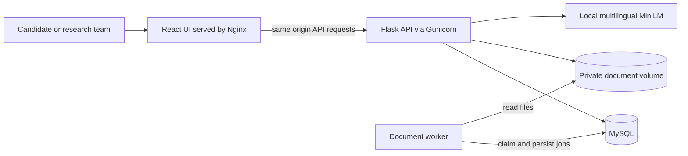
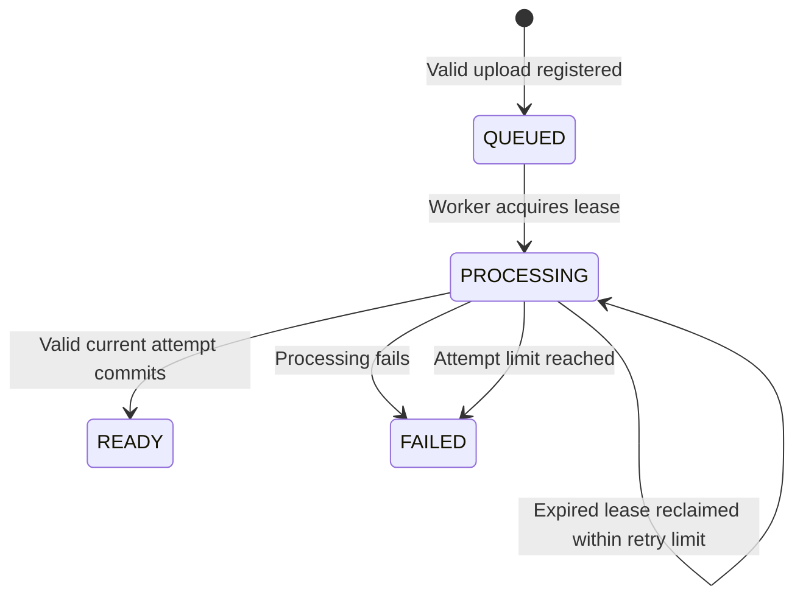
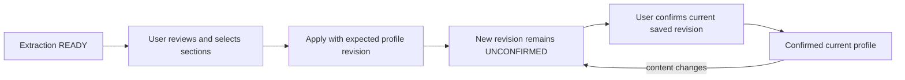

# Research Matching Architecture

The application separates private document processing, user-controlled profile confirmation and permission-aware matching. Its Docker runtime has four services: a React frontend served by Nginx, a Flask API served by Gunicorn, a document worker and MySQL.

## Runtime and data flow



The browser uses relative `/api/v1` requests. Nginx proxies them to the backend service, keeping frontend requests and session cookies on the same origin. The API and worker share document storage and database records. The worker is a separate process; a database-backed queue avoids requiring an additional broker for this project's workload.

## Backend boundaries

| Boundary | Responsibility |
| --- | --- |
| Routes | Authentication, CSRF, request DTOs, transaction entry and HTTP responses |
| Application services | Business operations, revision checks, state transitions and repository coordination |
| Repositories | Queries and related writes using the supplied SQLAlchemy Session |
| Serializers and schemas | Explicit response structures, canonical fields and validation |
| Database | Records, relations, constraints and protected write transactions |

The caller establishes the write transaction. Services and repositories share its Session; they do not commit independently. This allows a tag write, imported content and provenance updates to roll back together. Parsing and model inference remain outside write transactions.

My BE-2 and BE-3 work applies these boundaries to reviewed import and profile operations. Other project features have their own evolution and implementation history.

## Document lifecycle



Each claim has a persistent attempt token and expiry. A result writer must still own the current unexpired lease for a document in `PROCESSING`. This prevents a late worker from overwriting a newer attempt or a completed result. Expiry permits recovery when a worker next polls; it does not forcibly stop an older process.

`READY` means suggestions are available. It does not mean profile content has been imported or confirmed.

## Review and confirmation



Three operations deliberately differ:

| Operation | Revision and confirmation behaviour |
| --- | --- |
| Changed manual save | Increment once and clear confirmation |
| Canonical no-op save | Preserve revision, confirmation and timestamps |
| Successful reviewed import | Increment once and clear confirmation, including identical-content imports |
| Confirmation | Confirm the current revision without incrementing it; repeating it preserves the first confirmation timestamp |

Stale writes return `409 / REVISION_CONFLICT` with the stored revision. Partial imports preserve omitted sections and provenance; explicit empty values clear the selected fields where allowed.

## Matching and permissions

Team discovery requires an active, currently confirmed profile with discovery consent. Team-visible field projections are applied before building scoring inputs. Original files, full resumes and hidden fields remain outside those inputs.

The matching engine preserves structured evidence statuses. A separate requirement scorer can use local multilingual embeddings for permitted comparable fields. Each requirement receives a score; required requirements have weight 2 and preferred requirements weight 1:

```text
recommendationScore = sum(requirementScore × requirementWeight) / sum(requirementWeight)
```

Missing requirements contribute zero while remaining in the denominator. No requirements produces a null total. Semantic relevance does not establish a qualification or override an explicit confirmed skill gap. A model failure discards partial semantic output and uses the structured fallback for affected rows.

The current runtime uses `paraphrase-multilingual-MiniLM-L12-v2` through local ONNX inference. The older US-13 interest experiment is a separate historical evaluation; its metrics are not a benchmark for the current full matching application.

[Current scoring rules](../semantic-matching.md) · [Scoring service](../../backend/src/features/matching/requirement_scoring.py) · [Model configuration](../../backend/src/features/matching/semantic_config.json)

## Frontend and delivery

The frontend combines React pages and hooks with selected TypeScript contract adapters and review use cases. Read cancellation, request-generation checks, draft guards and revision-aware recovery prevent stale reads or background refreshes from silently replacing current work.

GitLab CI runs frontend type checking and tests, formatting, sharded SQLite and MySQL tests, live frontend/API integration and model checks. The acceptance stage verifies required reports before the frontend build. Pipeline artifacts retain test and acceptance evidence. Deployment is performed through the documented Docker workflow.

[Frontend boundaries](../../frontend/src/features/documents/extraction-review-use-cases.ts) · [Pipeline](../../.gitlab-ci.yml) · [Runtime configuration](../../compose.yaml)
