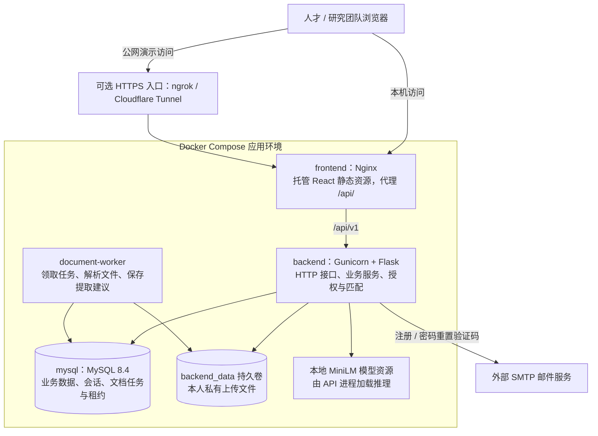
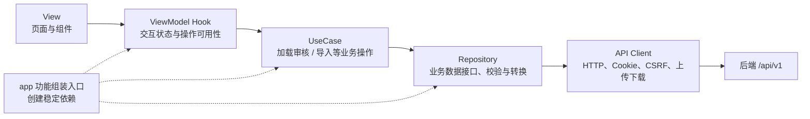
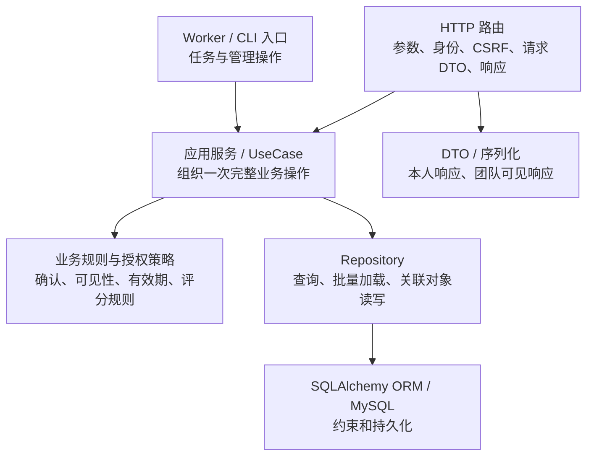
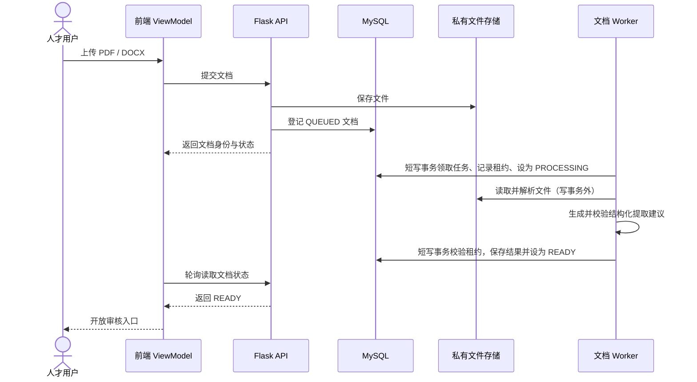

# 项目目标架构说明（Sprint 3 改造完成后的形态）

> 项目：COMP3900 / H18ABANANA 研究人才与研究机会匹配系统  
> 编写日期：2026-11-09（Australia/Sydney）  
> 参考代码：`629a037`（`finish be-08`）  
> 文档性质：目标设计。描述 Sprint 3 前后端改造全部完成后，各模块应如何协作；具体完成情况仍以代码、合并记录和验收证据为准。

本文依据 [Sprint 3 开发规划](README_SPRINT_3_DEVELOP_CN.md)、当前代码和已有专题文档整理。规划用于分配任务，本文用于解释最终的系统结构、职责边界和运行过程。图中的逻辑层不意味着分别部署成独立服务，示意目录和操作名也不代表当前已经存在。

## 1. 项目要实现什么

系统连接两类用户：

| 用户 | 核心目标 | 主要操作 |
| --- | --- | --- |
| 研究人才 `TALENT` | 找到适合自身背景的研究机会，并控制哪些信息可以被团队看到 | 维护档案、上传简历、审核提取结果、确认档案、管理隐私、查看推荐、收藏机会 |
| 研究团队 `RESEARCH_TEAM` | 发布机会，按具体需求发现和筛选人才 | 管理机会及需求、发布和重新开放机会、检索人才、查看匹配依据、维护 shortlist |

目标架构围绕三个结果组织：

1. **数据可信。** 文档提取只是建议，用户审核导入后还需显式确认；匹配使用当前已确认的档案版本。
2. **匹配可解释。** 每条需求分别评分，返回证据、缺口、权重和评分方式，前端展示服务端结果。
3. **修改可控。** 页面交互、业务规则、持久化和后台任务各有明确归属，并能独立验证。

整体采用**前后端分离、按业务功能组织的模块化单体，配合独立文档 Worker**。保留 React/Vite、Flask、SQLAlchemy、MySQL 和现有 `/api/v1` 接口，逐步调整内部职责。

## 2. 系统整体结构



默认部署包含 `frontend`、`backend`、`document-worker`、`mysql` 四个服务。API 和 Worker 共享后端代码及镜像，分别运行 Web 入口和后台处理命令。文档处理使用数据库中的任务状态和租约协调。

浏览器从同一入口获取页面并请求 `/api/v1`。Nginx 将 API 请求转发到内部 `backend:8000`，这样公网演示和本机使用可以沿用同一套前端请求路径。开发时由 Vite 提供前端服务，部署时使用构建后的静态资源。

## 3. 前端目标架构

### 3.1 分层与职责

前端采用适合 React 的 MVVM 分层思路：View 负责展示，ViewModel Hook 管理交互，UseCase 表达业务操作，Repository 管理业务数据边界。



实线表示主要调用方向；数据沿调用链返回。业务操作简单时，ViewModel 可以直接调用有意义的 Repository 方法，按复杂度选择必要层次。

| 层次 | 负责什么 | 典型内容 |
| --- | --- | --- |
| View | 页面结构、字段组件、翻译、可访问性提示和用户事件 | `DocumentsPage`、`ExtractionReview`、档案与匹配页面 |
| ViewModel Hook | 草稿、选中部分、确认勾选、查询/提交状态、冲突恢复、关闭保护 | 目标 `useExtractionReviewViewModel`；已有 `useProfileEditor`、`usePrivacyEditor` 等基础 |
| UseCase | 一次有业务意义的操作及必要的多请求编排 | `LoadExtractionReview`、前端 `ApplyReviewedExtraction` |
| Repository | 面向业务的数据方法、关键响应校验、DTO 转换和可替换依赖 | 文档审核读取、档案读取、提交已审核内容 |
| API Client | 请求发送、会话初始化、CSRF 配对、传输错误及读请求取消 | 复用 `src/api/client.js` |
| app / layout / shared | 功能组装、工作区外壳、通用状态工具和 UI | 工作区配置、`useResource`、`useMutation`、`useVersionedEditor`、国际化 |

UseCase 使用普通函数即可，通过参数接收 Repository，保持与 JSX、React state、翻译函数解耦。这样可以直接用内存数据验证“加载哪个文档”“提交哪个版本”，无需启动整个页面。

前后端可以使用相同的业务操作名称：前端操作负责准备和提交用户意图，后端操作负责最终权限、版本检查和原子写入。

### 3.2 类型与数据边界

以文档审核为 TypeScript 试点，允许现有 JS/JSX 与新增 TS/TSX 共存。试点建立 DTO、运行时校验器及独立 `typecheck` 检查，再按需要逐步推广。

需要明确区分三类数据：

- **传输 DTO：** 后端返回的档案、revision、确认信息、提取结果、错误和评分结构。
- **已保存快照：** 经过校验、可以作为下一次写入基线的服务端数据。
- **页面草稿：** 用户尚未提交的编辑值、选中部分和确认勾选。

网络返回的 JSON 先经过运行时校验，再进入交互状态。关键检查包括文档/机会身份、版本号、确认结构、提取部分和评分字段。TypeScript 类型用于开发检查，运行时校验用于处理实际收到的数据。

### 3.3 查询、编辑与账户隔离

| 场景 | 目标行为 |
| --- | --- |
| 首次进入某资源 | 显示首次加载状态，成功后建立该上下文的数据 |
| 同一资源后台刷新 | 保留上次成功内容，单独显示刷新中或可恢复的刷新失败 |
| 切换文档、账户、页码或筛选条件 | 清除旧上下文展示，取消过期读取，并拒收迟到响应 |
| 权限失效、资源不可访问或档案不再符合匹配资格 | 清除相关受保护数据和详情 |
| 编辑器已有草稿 | 后台刷新保持草稿与提交基线；显式读取最新版本用于比较 |
| 保存成功且响应有效 | 用服务端规范化结果更新快照，通知相关只读列表刷新 |
| 版本冲突或写入结果不确定 | 保留输入，读取并比较最新状态，由用户明确选择后继续 |

`useResource` 统一读取语义，`useMutation` 管理提交生命周期和重复点击保护，`useVersionedEditor` 统一版本草稿与恢复规则。功能 ViewModel 组合这些能力，避免页面各自实现一套。

账户变化会重建工作区；会话代次和请求生命周期检查共同阻止旧账户的迟到响应、通知或刷新回调进入新账户。依赖失效通知只广播业务域名称，不携带档案内容。

## 4. 后端目标架构

### 4.1 按业务模块分层



| 层次 | 目标职责 | 约束 |
| --- | --- | --- |
| HTTP 路由 | 适配请求和响应、调用身份/CSRF 校验、开启请求所需事务、调用应用服务 | 将完整业务流程交给服务，避免跨路由复用实现 |
| 应用服务 | 组织版本检查、状态变化、标签解析、来源记录与持久化 | 接收明确参数及 Session，可在无 HTTP 请求上下文下测试 |
| 业务规则 / 策略 | 当前版本确认、团队可见性、机会有效期、匹配与评分 | 在各入口复用同一套规则 |
| Repository | 数据查询、关联读写、批量读取和必要过滤 | 使用调用方提供的 Session；提交事务由入口统一负责 |
| DTO / 序列化 | 输出契约字段、时间格式和按受众允许返回的数据 | 本人完整档案与团队可见档案采用明确边界 |
| ORM / 数据库 | 数据模型、唯一约束、外键、索引和存储一致性 | ORM 结构与公开响应结构分别维护 |

例如，文档导入路由解析输入后调用导入服务。服务组织档案、标签和来源的更新，Repository 处理实际读写，共享序列化模块生成本人档案响应。这样文档模块可以复用档案能力，无需导入 `profile/routes.py`。

### 4.2 事务归属

**业务操作定义哪些修改必须一起成功；HTTP、Worker 或 CLI 入口负责开启和结束事务。** 鉴权、服务和 Repository 使用同一个 Session。

一次文档导入需要原子完成：档案字段替换、个人标签解析和关联、来源更新、revision 加一、确认失效。任一步失败，整笔数据库修改回滚。

事务执行顺序为：

```text
入口开启写事务并取得所需写保护
  → 使用同一个 Session 检查身份与权限
  → 读取当前资源并比较预期版本
  → 应用服务组织业务规则和 Repository 写入
  → 构造返回数据
事务成功提交；发生异常则回滚
```

保留现有 MySQL `DatabaseWriteLock` 写保护以及 SQLite 写事务机制，后续根据并发验收和测量决定是否细化锁粒度。文件解析、模型推理等耗时工作在写事务外执行，缩短持锁时间。

文件系统与数据库之间通过补偿处理失败，例如上传文件落盘后数据库登记失败时清理文件。数据库事务不能直接回滚文件系统操作。

## 5. 业务模块与数据归属

前后端均围绕业务功能组织代码，数据库作为共享持久化设施。模块边界说明谁负责规则及读写，并不要求每个模块拥有独立数据库。

| 模块 | 核心职责 | 主要数据或关联 |
| --- | --- | --- |
| auth | 注册、登录、会话、密码规则、密码重置、验证码邮件 | users、auth_sessions、验证码及尝试次数记录 |
| profile | 本人档案保存、确认、技能/兴趣/学术记录及来源 | talent_profiles、技能和兴趣关联、文本与来源记录 |
| privacy | 发现授权和字段可见性 | privacy_settings、privacy_visible_fields；独立隐私 revision |
| documents | 上传、本人下载、提取任务、审核导入 | documents、document_processing_leases、document_extractions、私有文件 |
| opportunities | 机会编辑、需求、发布、有效期、显式重新开放 | opportunities、opportunity_requirements、需求标签及技能详情 |
| matching | 本人推荐、团队人才发现、逐条评分、证据和排序 | 读取当前合格机会与允许使用的档案投影 |
| collections | 人才收藏机会、团队 shortlist | 收藏关系；读取时重新检查资源权限和资格 |
| 基础设施 | 数据库连接、升级、存储、模型、日志和健康检查 | SQLAlchemy、持久卷、本地模型资源、requestId |

重要关联是：用户拥有档案和文档；档案拥有隐私设置、内容及来源；团队拥有机会；机会包含多条需求；文档拥有处理租约与提取结果。提取结果与正式档案分别保存，用户审核导入才会改变档案。

## 6. 核心流程：上传简历到形成匹配

### 6.1 上传与异步提取



文档状态为 `QUEUED → PROCESSING → READY / FAILED`。租约带有 token、过期时间和尝试次数。Worker 中断后，其他 Worker 可在租约过期后接手；旧租约的迟到成功或失败结果必须被拒收。

前端在仍有处理中任务时，于上次读取完成约 2 秒后再查询，避免重叠轮询。自动检查采用 60 秒墙钟预算；页面隐藏时不启动新轮询，隐藏时间仍消耗预算。预算耗尽只暂停检查，用户可以手动刷新并重新开始预算。

文档 READY 表示提取建议可供审核，档案内容和确认状态尚未因此改变。

### 6.2 审核、部分导入与确认

1. 前端加载选中文档的提取结果和当前档案，建立固定的审核上下文及档案版本基线。
2. 用户修改建议，选择要导入的部分，并勾选理解导入影响；修改内容或选中部分后需重新勾选。
3. 前端提交文档 ID、`expectedProfileRevision` 和已选 `sections`。
4. 后端检查本人所有权、READY 状态、档案版本和输入，原子保存内容、标签和来源。
5. 成功导入使档案 revision 加一，清除确认版本及时间，返回规范化的 `UNCONFIRMED` 档案。
6. 用户查看保存结果，再通过独立确认操作提交当前 `expectedRevision`。
7. 后端确认通过后，该版本才能用于匹配；团队发现还要求用户授权并遵循字段可见性。

**提取、导入、确认是三个独立动作。** 每次成功导入都会增加一次档案版本并使确认失效；普通档案保存则仅在内容真实变化时增加版本，完全相同的保存保留原版本、确认信息和来源。

部分导入只替换提交的部分，其他部分及来源保留。按契约用 `[]` 清空列表、用 `""` 清空文本；共享标签解析引起的规范化补充沿用现有规则，并在响应中返回。

### 6.3 状态之间的关系

```text
文档：上传 → QUEUED → PROCESSING → READY / FAILED
                                       ↓ 用户审核并导入
档案：UNCONFIRMED ← 内容修改或成功导入
       ↓ 用户显式确认当前 revision
      CONFIRMED（confirmedRevision == revision）
       ↓ 当前确认 + 已授权发现 + 账户有效
团队可发现：仅使用允许公开的字段
```

档案内容 revision、隐私 revision 和机会 revision 分别维护。确认绑定档案内容版本；保存隐私时检查隐私自身版本，避免将不同资源的并发控制混在一起。

## 7. 核心流程：权限、匹配与推荐

### 7.1 先确定允许使用的数据


本人查看自己的推荐可以使用本人允许用于匹配的数据；团队发现只使用当前授权的字段。**字段可见性同时约束搜索、筛选、模型输入、评分、排序和返回证据。** 隐藏内容不应通过分数或排名间接泄露。

完整简历描述、原文件、文档来源和私有存储路径保持本人私有。收藏或 shortlist 保存的是关系，重新读取仍执行当前权限检查。撤回发现授权后，后续新请求立即按新权限处理；前端在后续重新验证时清除失效展示。

### 7.2 逐条需求评分

匹配模块分工为：Repository 提供合格候选与允许使用的快照，结构化引擎判断状态和证据，语义运行时批量编码必要文本，逐条评分逻辑计算分数和贡献，应用服务汇总并排序。

每条需求有独立分数 `s_i` 和重要性权重 `w_i`：

```text
REQUIRED 权重 = 2
PREFERRED 权重 = 1
recommendationScore = Σ(s_i × w_i) / Σ(w_i)
```

例如，三条需求分数依次为 80（必需）、60（偏好）、0（必需），总分为 `(80×2 + 60×1 + 0×2) / 5 = 44`。

目标行为沿用当前逐条评分规则：

- 结构化状态和证据保留；语义评分补充相关性，明确缺口、否定陈述和缺少证据有各自处理。
- 学历层级、机构身份、成果类型等精确条件按相应规则匹配；学术需求的证据来自同一条合适记录。
- 未满足或缺少证据的需求仍保留在权重分母中；没有需求时总分为 `null`。
- 模型不可用时回退到已有结构化结果，并标明不可用状态；前端展示原因和服务端返回值。
- 当前总分由逐条需求加权得到；结构化覆盖率单独展示，兴趣诊断的排名权重为零。

模型对象可在应用进程内复用，用户文本和向量限定在单次请求内。模型资源在构建或准备阶段提供，请求处理使用本地资源。详细算法及限制见 [语义评分说明](semantic-matching.md)。

### 7.3 查询优化的边界

普通机会列表可以在语义等价的前提下由数据库执行过滤、计数、稳定排序和分页，只批量加载当前页需要的关联数据。

推荐和人才匹配需要对**全部符合条件的候选评分后排序，最后分页**。将候选预先截成一页会改变全局排名，因此优化集中于等价过滤、必要字段投影、批量关联读取和有依据的索引。

Unicode 文本过滤保留 NFKC、空白折叠及 casefold 等现有规则。当前 BE-8 对无法跨数据库等价下推的文本条件保留应用层精确比较，普通文本列表只读取必要列，再加载当前页完整数据。详见 [BE-8 查询说明及证据](testing/be8/README.md)。

## 8. 并发、错误与恢复约定

| 问题 | 后端保障 | 前端行为 |
| --- | --- | --- |
| 两个请求修改同一版本 | 写保护下比较预期 revision；冲突返回 `409 / REVISION_CONFLICT` 和 `error.currentRevision` | 保留草稿，读取最新版本比较，用户选择后再继续 |
| 多表更新中途失败 | 内容、版本、确认、标签与来源一起回滚 | 显示失败，保留可恢复输入 |
| 写入已提交但响应丢失或成功响应无效 | 服务端可能已经完成操作 | 标记结果不确定，暂缓重复写入，通过读取核对恢复 |
| 过期读请求最后返回 | 每个新请求仍执行当前身份和权限检查 | 取消读取并独立校验生命周期，拒收过期结果 |
| CSRF 失效 | 返回明确的写入前拒绝 | 保留快照和草稿，引导恢复会话后显式重试 |
| Worker 租约过期 | 拒收旧 token 的结果，按尝试次数限制重领 | 展示权威状态，保留手动录入路径 |
| 机会到期 | 依据统一参考时间和有效期规则拒绝不合格机会 | 展示过期；重新开放使用显式操作 |

读请求取消用于停止无用读取；写请求超时或客户端中断不能证明数据库回滚，也不能作为自动重放的依据。冲突返回的版本提示用于说明问题，恢复提交基线需实际读取最新资源。

重复确认同一版本保留首次确认时间。机会仅修改截止时间时保留已经形成的过期状态，显式重新开放需要通过所有权、版本和发布条件检查。

API 错误沿用 `error.code`、`error.message`、`error.fieldErrors` 和 `requestId`，冲突额外携带 `error.currentRevision`。请求字段、错误码或响应结构调整时，同步 OpenAPI、示例和前后端消费者。

## 9. 目标代码组织示意

以下展示职责应落在哪里；具体文件可按实际规模合并。新增操作使用普通函数即可。

```text
frontend/src/
  app/                         工作区配置与稳定依赖组装
  layout/                      接收配置的工作区外壳
  api/                         通用 HTTP、会话与 CSRF
  shared/                      通用 Hook、UI、国际化、编辑恢复
  features/
    documents/
      views / components       文档列表与审核展示
      view-model               审核、轮询和交互生命周期
      use-cases                加载审核、提交已审核内容
      repository / dto         文档业务边界、类型和运行时校验
    profile/                   档案编辑、确认及数据边界
    privacy/                   发现授权与字段可见性
    opportunities/             机会编辑、发布与重新开放
    matching/                  推荐、人才发现、评分证据展示
    auth/                      登录、注册、会话恢复
    collections/               收藏和 shortlist 展示

backend/src/
  app.py                       应用及依赖组装、CLI 注册
  shared/                      安全、校验、分页等通用能力
  db/                          ORM、Session、数据库升级
  features/
    documents/
      routes.py                HTTP 适配
      service.py               审核导入等应用操作
      repository.py            文档及提取结果读写
      dto.py                   本人文档响应转换
      worker.py                任务入口与租约流程
      text / suggestions       文件解析与建议生成
    profile/                   保存、确认、档案查询与序列化
    privacy/                   隐私设置及授权策略
    opportunities/             机会操作、查询、有效期规则
    matching/                  候选读取、可见投影、引擎、语义评分
    auth/                      身份、安全与验证码邮件
    collections                收藏关系与当前资格检查
```

前端继续遵守功能边界：共享工具保持通用，API 客户端保持独立，工作区外壳通过配置接收页面。文档审核沿用复用档案字段组件的明确约定。后端共享能力从路由中抽出，通过服务、Repository 或 DTO 复用。

## 10. 部署、持久化与诊断

| 方面 | 目标约定 |
| --- | --- |
| 数据存储 | MySQL 8.4 保存业务数据，`mysql_data` 持久卷保存数据库文件；`backend_data` 保存上传文件 |
| 模型资源 | 构建/准备阶段固定模型版本和校验信息，API 本地加载；模型故障提供结构化回退 |
| 数据库升级 | 区分全新建库与旧库升级，统一升级顺序、重复执行检查及发布前验证；沿用已有升级命令逐步整理 |
| 健康检查 | 前端 `/healthz` 检查静态入口；后端 `/healthz` 检查数据库连通性；Worker 另行验证进程与任务处理 |
| 日志关联 | 沿用 `requestId`、`X-Request-Id`；Worker 记录任务关联信息、阶段、耗时和错误类别 |
| 敏感信息 | 日志保护密码、Cookie、CSRF token、简历正文、完整档案、模型输入及私有路径 |
| 发布恢复 | 在隔离数据副本验证备份恢复、升级失败处理和容器重建后的数据读取 |
| 公网演示 | 可选隧道接入前端入口，按实际 HTTPS 地址配置会话及来源；SMTP 独立配置 |

SQLite 保留用于现有测试及兼容场景；默认部署以 MySQL 为准，数据库兼容性与并发验收需要真实 MySQL 证据。前端健康通过、后端数据库可用、Worker 能正常完成任务和模型正常推理是不同检查项。

## 11. 当前基础与目标之间的关系

以下是对参考提交的静态核对及仓库文档归纳，帮助理解改造起点；不是本次重新执行的测试报告。

| 方向 | 当前可见基础 | 全部改造后的目标 |
| --- | --- | --- |
| 前端数据边界（FE-1） | React/JSX、集中 API 客户端，部分编辑器已有响应校验；`package.json` 尚无 TypeScript 和 `typecheck` | 审核试点具备类型、运行时校验、Repository 与稳定依赖组装 |
| 审核分层（FE-2） | `ExtractionReview.jsx` 仍集中加载、审核和提交逻辑 | 专用 ViewModel、可独立调用的加载/导入 UseCase，View 专注展示 |
| 查询与编辑（FE-3 / FE-4） | 已有共享查询、文档轮询、版本编辑及恢复工具，见专题实现说明 | 在后续类型和服务整理中保持一致语义，完成最终联调 |
| 档案和导入（BE-2 / BE-3） | 关键业务规则仍在路由内，documents 路由仍引用 profile 路由 | 抽出服务、Repository、序列化，复用档案能力 |
| 并发和权限（BE-4 / BE-5） | 已有写锁、版本检查、发现授权和团队投影 | 统一入口与职责，补齐真实并发、故障回滚及隐私输入验收 |
| 后台任务（BE-6） | 已有租约、超时重领、结果校验和旧结果拒收 | 保持处理协议，验证跨进程恢复与任务诊断 |
| 匹配与查询（BE-7 / BE-8） | 已有逐条需求评分和查询优化，仓库内有对应验收报告 | 保持授权输入、全局评分与分页语义，纳入整体验收 |
| 契约与交付（FE-5、BE-1 / BE-9 / BE-10） | 已有 OpenAPI、样例、数据库升级命令和多类 CI 作业 | 完成契约对照、统一升级流程、最终集成证据与发布说明 |

## 12. 怎样判断目标架构已经落地

验收同时检查职责结构和可观察行为：

1. 文档审核 View 不再直接编排多请求、版本选择和导入流程；UseCase 可注入替代 Repository 独立验证。
2. 后端档案与导入业务可脱离 HTTP 请求调用，documents 路由对 profile 路由的实现依赖已经移除。
3. 真实完成“上传 → Worker 提取 → 选择部分导入 → 未确认 → 显式确认 → 推荐/团队匹配”链路。
4. 独立连接并发修改同一档案版本时，一次真实修改成功，另一次冲突；注入中途故障后无部分写入。
5. 只改变隐藏内容并重新确认时，团队筛选、评分、排名及证据保持一致；撤回授权后新请求遵守新权限。
6. Worker 重启、租约重领、迟到结果和重试上限符合协议，前端暂停轮询不改变服务端文档状态。
7. 写响应丢失或无效时，页面保留输入并要求核对；账户切换和迟到响应不会污染当前工作区。
8. 推荐覆盖全部合格候选再排序分页；真实模型、模型回退及 MySQL 路径按要求执行，记录失败和跳过项。
9. TypeScript 试点检查、前端构建、契约、前后端联调、数据库升级和恢复验证形成可追溯的交付证据。

## 13. 参考资料

- [Sprint 3 前后端改进开发说明](README_SPRINT_3_DEVELOP_CN.md)：任务范围、依赖和验收要求。
- [API 文档入口](api/README.md)、[OpenAPI](api/openapi.json)：请求、响应和错误契约。
- [FE-3 查询、取消与轮询](fe3-query-polling.md)、[FE-4 编辑与恢复](fe4-editor-state.md)：已有前端状态约定。
- [逐条需求语义评分](semantic-matching.md)、[BE-7 验收](testing/be7/README.md)、[BE-8 查询优化](testing/be8/README.md)：评分与查询规则及已有证据。
- [Docker 集成](docker-integration.md)、[MySQL 迁移](mysql-migration.md)、[启动说明](../README_BEFORE_START.md)：环境、存储和运维操作；实际服务定义以 [compose.yaml](../compose.yaml) 为准。
